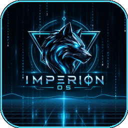

#  IMPERION OS

> **A Futuristic Cyberpunk Desktop Operating System & Productivity Workstation written entirely in pure Java & Swing.**

[](https://openjdk.org/)
[](https://microsoft.com)
[](https://docs.oracle.com/javase/tutorial/uiswing/)
[](LICENSE)

---

## ⚡ Overview

**IMPERION OS** is a complete, standalone cyberpunk desktop operating system simulator. Designed with a high-contrast neon aesthetic, sleek fluid glassmorphism, and responsive sound effects, it combines everyday office productivity with deep hardware-level network reconnaissance tools.

Everything runs locally on top of the JVM with zero external runtime GUI dependencies.

---

## ✨ Key Highlights & Features

### 🖥️ Desktop Shell & System Core
* **Futuristic Window Manager**: Draggable, resizable, minimizable internal windows with z-order layering, titlebar controls, and neon accent frames.
* **Animated Cyberpunk Desktop**: Real-time particle grids, dynamic wallpapers, system tray clock, and application taskbar with live status icons.
* **Start Command Hub**: Searchable application launcher with categories (Productivity, System, Media, Utilities, Games).
* **Cyber Security & Lock Screen**: Biometric face authentication simulation, PIN lock protection, and live host telemetry (CPU, RAM, JVM heaps).

### 📑 Office & Productivity Suite (Microsoft-Inspired)
* **CyberWord (Word Processor)**: Microsoft Word–style blue quick-access toolbar (`#185ABD`), 5-tab Office ribbon (`Home`, `Insert`, `Layout`, `Review`, `View`), rich typography, tables, image insertion, format painter, docx import/export, and live word telemetry.
* **CyberSheets (Spreadsheet)**: Microsoft Excel–style green quick-access bar (`#107C41`), interactive formula bar with address jumping (`B5` + Enter), Function Wizard (`SUM`, `AVERAGE`, `COUNT`, `MAX`, `MIN`), custom borders, and Excel-style stats.
* **CyberSlides (Presentation Editor)**: Microsoft PowerPoint–style red quick-access bar (`#C43E1C`), slide deck filmstrip, visual canvas composer, and full-screen slideshow presentation engine (`F5`).
* **Notepad**: Windows 11 Fluent-style multi-tab text editor with line numbers, find & replace, zoom controls, and theme toggling.

### 🌐 NetRunner CyberDeck & 3D Gyro Radar
* **3D Gyroscope Proximity Radar**: Real-time 3D perspective projection mapping nearby devices in physical space relative to your workstation center.
* **Over-The-Air RF & Bluetooth Sniffer**: Passively detects 802.11 beacon frames and Bluetooth broadcasts over the air without requiring a Wi-Fi connection.
* **4-Tab Deep Telemetry HUD**: Inspect any detected node to view live Overview, RF Spectrum (center frequency, Wi-Fi generation, RSSI dBm), Security cipher suites, and IPv4 / MAC addressing.
* **Subnet Scanner & Port Auditor**: Multi-threaded parallel subnet sweep, ARP cache interrogation, live ping oscilloscope, and TCP service port auditing.

### 🎮 Media, Creative & Entertainment
* **Cyber Arcade**: Built-in retro arcade titles including Cyber Snake and Hacker Breaker.
* **Media Player**: Integrated audio/video player with playlist management and visualizer oscilloscope.
* **Document Viewer**: Multi-page document and PDF inspection engine.
* **Cyber Paint & Image Viewer**: Canvas sketching suite with neon brushes, geometric shapes, and image galleries.
* **Sandboxed Terminal**: Monospace cyber shell with multi-session tabs (`Ctrl+T`), quick shortcut buttons (`pwd`, `ls`, `clear`, `whoami`), command history, and tab auto-completion.

---

## 🚀 Quick Start

### Prerequisites
* **Java Development Kit (JDK) 17 or higher** (Tested on OpenJDK 17, 21, and 27)
* Windows 10 / 11

### One-Click Launch

Clone the repository and run:

```bat
# Clone repository
git clone https://github.com/Shreeskanda/Imperion-OS.git
cd Imperion-OS

# Compile and launch in one step:
build_and_run.bat
```

Or compile and run individually:

```bat
# Compile all source files into bin/
build.bat

# Launch IMPERION OS workstation
run.bat
```

---

## 📂 Project Structure

```
Imperion-OS/
├── src/javaos/
│   ├── Main.java                     # Application bootstrap & entry point
│   ├── core/                         # OS orchestrator, Window & Process managers
│   ├── ui/                           # DesktopFrame, Taskbar, StartMenu, ThemeManager
│   │   └── components/               # Cyberpunk vector icons, neon cards, buttons, scrollbars
│   ├── services/                     # NetworkScanner, Sound, VirtualFS, SystemMetrics
│   ├── models/                       # Data models & telemetry definitions
│   └── apps/                         # 20+ built-in OS applications
│       ├── CyberDeckApp.java         # 3D Gyro Proximity Radar & RF sniffer
│       ├── WordEditorApp.java        # CyberWord processor (.docx & ribbon)
│       ├── SpreadsheetApp.java       # CyberSheets spreadsheet engine
│       ├── PresentationEditorApp.java# CyberSlides presentation builder
│       ├── NotepadApp.java           # Windows 11 multi-tab editor
│       ├── TerminalApp.java          # Tabbed sandboxed command interpreter
│       ├── CyberSecurityApp.java     # System security & audits
│       ├── RealFileManagerApp.java   # Native filesystem explorer
│       ├── MediaPlayerApp.java       # Audio/Video playback
│       ├── ArcadeApp.java            # Built-in retro arcade games
│       └── PaintApp.java             # Cyber canvas drawing studio
├── data/                             # Virtual files, settings, and icon assets
├── scripts/                          # Auxiliary python bridges (doc renderer & auth)
├── build.bat                         # Fast incremental batch compiler
├── run.bat                           # Clean background process launcher
├── build_and_run.bat                 # All-in-one build & execute script
└── README.md
```

---

## ⌨️ Global Keyboard Shortcuts

| Shortcut | Action |
|:---|:---|
| `Ctrl + Alt + T` | Open Cyber Terminal |
| `Ctrl + Alt + F` | Launch File Manager |
| `Ctrl + Alt + L` | Lock Imperion OS Workstation |
| `Ctrl + S` | Save active document / sheet / note |
| `F5` | Start Full-Screen Presentation in CyberSlides |
| `Ctrl + T` | Open new tab in Terminal / Notepad |

---

## 👤 Author

Developed by **[Shreeskanda N](https://github.com/Shreeskanda)**

*GitHub:* [@Shreeskanda](https://github.com/Shreeskanda)
